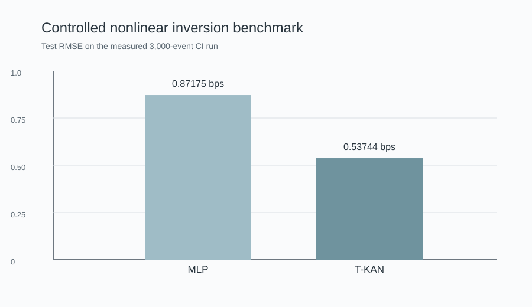
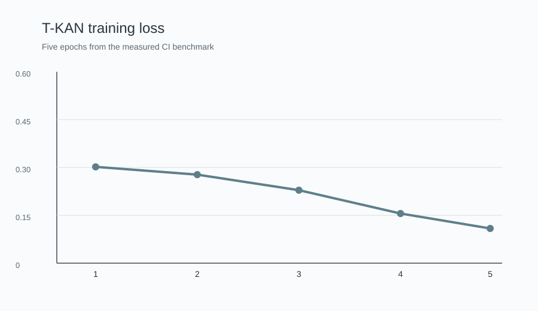
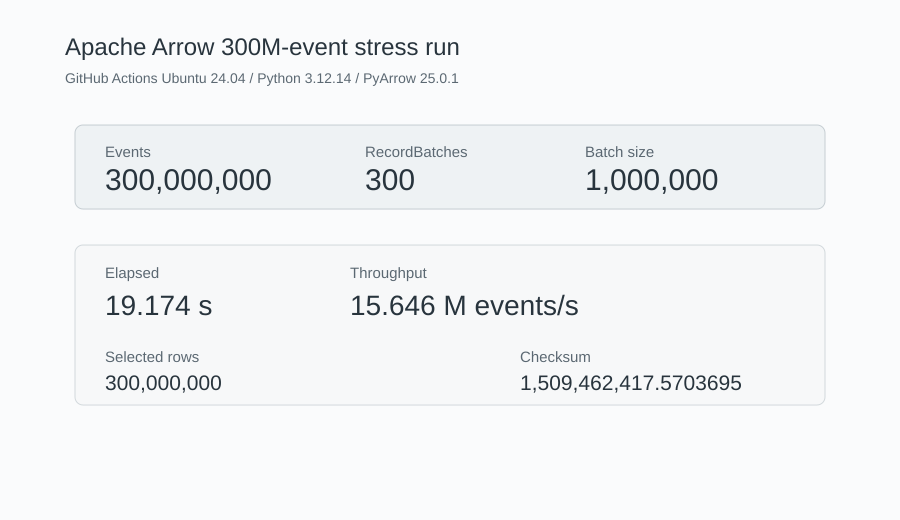
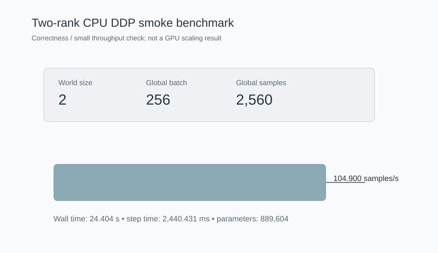

# T-KAN Microstructure Engine

**Maintainer:** Pirate-Emperor

A research implementation for studying event-level limit-order-book (LOB) features with a Temporal Kolmogorov-Arnold Network (T-KAN), Apache Arrow columnar processing, and PyTorch DistributedDataParallel (DDP).

The default examples use seeded synthetic data, so the full pipeline can be checked without private exchange feeds. Real Parquet data can be supplied separately when its license and terms permit the intended use.

## Components

| Area | Implementation |
|---|---|
| Temporal model | B-spline edge activations, adaptive spline grids, and a causal temporal mixer |
| LOB features | Spread, queue imbalance, microprice displacement, signed trade, ten depth-imbalance features, and midpoint return |
| Columnar processing | Apache Arrow RecordBatch processing, q-like filter/select/range/group helpers, and streaming Parquet scans |
| Training | PyTorch DDP, distributed sampling, CUDA automatic mixed precision (AMP), optional fused AdamW, gradient clipping, and synchronized spline-grid state |

Source code is in `src/tkan_engine`; runnable commands are in `scripts/`.

## Measured results

<!-- CI_VALIDATION_START -->
Fresh test counts and the latest complete CI run will be recorded here after all test, data-stream, distributed-training, and plot jobs pass.
<!-- CI_VALIDATION_END -->

### Controlled nonlinear inversion

This experiment fits a known nonlinear target and compares a small MLP with T-KAN. It uses synthetic order-flow features and is a representation-learning test, not a trading backtest or exchange replay.

Configuration: 3,000 observations, sequence length 16, chronological 80/20 split, 5 epochs, batch size 128, hidden dimension 16, and spline grid size 6.

<!-- INVERSION_METRICS_START -->
| Model | Parameters | Test MSE (bps²) | Test RMSE (bps) | Test IC |
|---|---:|---:|---:|---:|
| MLP | — | — | — | — |
| T-KAN | — | — | — | — |
<!-- INVERSION_METRICS_END -->







The run details and training history are stored in results/ci_inversion_3000.json.

### Seed and noise sensitivity

A separate experiment repeats the MLP and T-KAN comparison across several random seeds and target-noise levels. It reports mean test error, run-to-run standard deviation, information coefficient, and the paired RMSE difference for each noise level.

<!-- INVERSION_SWEEP_START -->
The multi-seed sensitivity sweep will be recorded in results/inversion_sweep.json and summarized here after the CI experiment completes.
<!-- INVERSION_SWEEP_END -->

### Apache Arrow event processing

The stress generator creates synthetic event batches and runs columnar feature calculation, filtering, projection and checksum calculation one batch at a time. It does not build a 300M-row table in memory.

| Events | Batch size | Batches | Elapsed time | Throughput | Selected rows |
|---:|---:|---:|---:|---:|---:|
| 5,000,000 | 250,000 | 20 | 0.513 s | 9.752M events/s | 5,000,000 |
| 300,000,000 | 1,000,000 | 300 | 26.934 s | 11.138M events/s | 300,000,000 |

The 300M-event result is a synthetic Arrow stress test, not a claim that 300M real exchange messages were replayed. Its checksum was `1,509,462,417.5703695`. The two timings come from separate CI jobs and should not be treated as a controlled hardware scaling comparison.




Saved run data: `results/arrow_benchmark_5m.json` and `results/arrow_benchmark_300m.json`.

### Distributed training smoke test

The recorded two-rank DDP smoke test ran on CPU. It processed 2,560 samples in 21.005 seconds at 121.878 samples/second. This verifies a basic distributed execution path, **not** multi-GPU scaling.



The exact metrics are in `results/ddp_benchmark_cpu.json`.

### A100 training results

<!-- GPU_RESULTS_START -->
No A100 throughput or GPU arithmetic-intensity result has been recorded in this checkout. The `integrator-1` runner was offline during this validation on 16 October 2026, so no GPU metric is claimed. To measure it, manually launch the `tkan-engine-a100-validation` workflow from the repository where that runner is registered. The workflow checks out this project, validates the visible A100 40GB devices, runs the test suite and benchmarks, and uploads the metrics and plots as an artifact. CPU DDP results are not a substitute for this measurement.
<!-- GPU_RESULTS_END -->

## Installation

Python 3.10, 3.11 and 3.12 are covered by the continuous-integration matrix.

### Linux or macOS

```shell
git clone https://github.com/SpryzenHell/tkan_engine.git
cd tkan_engine
python3.12 -m venv .venv
source .venv/bin/activate
python -m pip install --upgrade pip
python -m pip install -e ".[full]"
```

Use an available Python 3.10 or 3.11 interpreter in place of `python3.12` when required.

### Windows PowerShell

```powershell
git clone https://github.com/SpryzenHell/tkan_engine.git
cd tkan_engine
py -3.12 -m venv .venv
.\.venv\Scripts\Activate.ps1
python -m pip install --upgrade pip
python -m pip install -e ".[full]"
```

For CUDA training, install the PyTorch build suited to the target machine first, then install the project. The code selects CUDA when it is available and otherwise uses CPU. No GPU benchmark is reported unless a CUDA run completes.

## Verify the installation

Run a quick environment and model check:

```shell
python scripts/self_check.py
```

Run the tests:

```shell
pytest
```

The test suite covers spline basis shapes and sums, forward/backward gradients, adaptive grids, temporal output shapes, feature values, stream continuity and reproducibility, input validation, and Arrow filtering, grouping and batch accounting where PyArrow is installed.

## Run the nonlinear inversion benchmark

```shell
python scripts/inversion_benchmark.py --events 3000 --epochs 5 --batch-size 128 --hidden 16 --grid-size 6
```

The OFI signal is generated from a stationary AR(1) process with persistence 0.85, then passed through tanh. The target is:

```text
0.9*sin(2.6*OFI[t]) + 0.55*OFI[t]^3
+ 0.25*(OFI[t] - OFI[t-1]) + N(0, noise_std^2)
```

The default noise standard deviation is 0.08 and can be changed with `--noise-std`. Input features use a trailing five-observation mean, not a centered window, so future observations are not included. The split is chronological. The script writes `results/inversion_benchmark.json`.

## Train the LOB model

```shell
python scripts/train.py --events 30000 --seq-len 64 --epochs 6 --batch-size 256 --hidden 48 --depth 2 --grid-size 8
```

The command writes `results/model_metrics.json`. This path materializes the requested development-sized event window into pandas; use the Arrow pipeline for large streaming tests.

## Run Arrow tests and stress runs

Small smoke test:

```shell
python scripts/benchmark_arrow.py --events 5000000 --batch-size 250000
```

Large synthetic stress test:

```shell
python scripts/benchmark_arrow.py --events 300000000 --batch-size 1000000
```

For a real Parquet dataset, provide a file or directory containing the columns `ts_ns`, `bid_px_1`, `ask_px_1`, `bid_sz_1`, and `ask_sz_1`:

```shell
python scripts/benchmark_arrow.py --input /path/to/parquet/dataset --batch-size 1000000
```

Record the dataset identifier, date range, symbols, machine specifications, library versions and exact command for each real-data measurement. Only use data that you are permitted to access and process. No pretrained model is required; the example models are trained from scratch.

## q-like operations

`src/tkan_engine/arrow_pipeline.py` provides small Arrow-backed helpers:

- `q_where`: filter rows using an Arrow expression.
- `q_select`: keep the requested columns.
- `q_within`: filter an inclusive numeric range.
- `q_by`: group rows and apply Arrow aggregations.

These helpers cover a useful subset of q-style operations. They are not a q interpreter or a replacement for a production KDB+/q deployment.

## Run DDP

Two-rank CPU smoke test:

```shell
torchrun --standalone --nproc_per_node=2 scripts/ddp_benchmark.py --distributed --events 10000 --steps 10 --batch-size 128
```

The same benchmark script selects CUDA when it is available and supports mixed precision and fused AdamW when supported. See the A100 workflow below for measured single-/multi-GPU runs.

### A100 benchmarks and profiling

The manual `tkan-engine-a100-validation` workflow must be launched from the repository where the self-hosted runner `integrator-1` is registered. It checks out this project at the selected branch or commit, confirms the A100 40GB devices and CUDA setup, runs the tests and Arrow stress tests, measures 1-, 2- and (when available) 4-GPU training, and saves a PyTorch profiler report. It uploads result JSON files, plots, and the updated benchmark summary as an artifact.

The workflow needs a matching runner that is online and has a working NVIDIA driver and CUDA-enabled PyTorch installation. For lower-level arithmetic-intensity counters, use Nsight Compute when it is installed on the GPU host; the PyTorch profiler is operator-level profiling and is not itself a hardware-counter measurement.

## Continuous integration

The CI workflow checks Python 3.10, 3.11 and 3.12; runs unit tests and the nonlinear inversion benchmark; executes 5M- and 300M-event Arrow paths; and runs a two-rank CPU DDP smoke test. The report job records the current single-run metrics and a nine-run seed/noise sensitivity sweep, generates twelve SVG plots from the saved JSON values, and attaches PNG copies as an action artifact.

## Figures and saved results

The twelve experiment plots are generated with Matplotlib from saved JSON results by:

```shell
python -m pip install "matplotlib>=3.8"
python scripts/render_report.py
```

The SVG plots are written under `docs/figures/`, and PNG copies under `results/figures/`. Architecture and feature diagrams are separate from the charts and are retained as supporting documentation. There are no terminal snapshots or a cover image in the README.

## Scope and limits

This is a research and benchmark project, not a production market-data or trading system. It has no exchange connection or order execution code. Synthetic test results do not establish trading returns or generalization to real markets. The Arrow 300M result demonstrates streaming columnar processing on generated data; a separate licensed replay dataset is required to measure real-market behavior.
